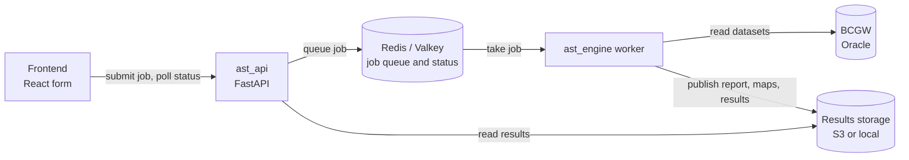

# Automated Statusing Tool

An open source implementation of GeoBC's Automated Statusing Tool (AST) and
Universal Overlap Tool (UOT).

**Status: under development.** The tool runs end to end, but it has not been
compared against the ArcGIS Pro tool it replaces and is not ready for
operational use. See [What is not done](#what-is-not-done).

## What it does

A status answers one question about a piece of Crown land: what else is already
there? Staff give the tool an area of interest (AOI), and it checks that area
against several hundred provincial datasets: parks, tenures, reserves, water
licences, archaeology sites and so on.

You give it:

- a region;
- an AOI, either an uploaded spatial file or a TANTALIS file, disposition and
  parcel number.

It gives back:

- a **status report**, an Excel workbook with the tabs staff already use:
  Crown Land Status, Status of Conflict, Conflicts & Constraints and Data
  Sources;
- optional **HTML maps**, one per dataset that found something, plus an
  overview;
- optional **GeoPackages** of the features each dataset matched;
- the full results as JSON.

The original tool is an ArcGIS Pro toolbox that runs on a desktop. This one is a
web application that needs no ArcGIS licence.

## How it works



1. A signed-in user submits the form. The API reads any uploaded file into an
   AOI and puts the job on the queue.
2. The worker takes the job, loads the dataset registries for the region and
   runs each dataset against the AOI.
3. The worker publishes the report, maps and results to storage and marks the
   job completed.
4. The form polls the job's status and shows download links when it is done.

[docs/job-flow.md](docs/job-flow.md) describes this path in detail, with every
API route and setting.

## Repository layout

| Folder | What it holds |
| --- | --- |
| `frontend/` | The web form: React, Vite, the BC Design System and OpenLayers. |
| `ast_api/` | The API the form talks to: FastAPI. |
| `ast_engine/` | The analysis engine, the queue worker, the report and map writers, and the registry builder. |
| `shared_models/` | The job models the API and the worker share. |
| `scripts/` | Helper scripts for running the engine by hand. |
| `docs/` | How the parts fit together. |

## Quick start with Docker

This runs the API, the worker, Valkey and a local S3 store. It uses a small
demo registry over sample data in the repo, so it needs no BCGW login.

1. Create a `.env` file in the repo root. It is not in git.

   ```bash
   REDIS_PASSWORD=<any value>
   RESULTS_S3_ACCESS_ID=<any value>
   RESULTS_S3_KEY=<any value>
   RESULTS_S3_BUCKET=ast-results
   AUTH_REQUIRED=false
   ```

   `AUTH_REQUIRED=false` lets you call the API without signing in. Use it for
   local work only.

2. Start the stack.

   ```bash
   docker compose up --build
   ```

3. Submit a job with a sample AOI.

   ```bash
   curl -X POST http://localhost:8000/api/jobs \
     -F name="Your Name" -F email="you@example.com" \
     -F region=kootenay_boundary -F source=2 -F generate_maps=true \
     -F upload_file=@ast_engine/tests/data/Test_Shape_A/Test_Shape_A.kml
   ```

4. Use the `job_id` in the reply to check the job and fetch its report.

   ```bash
   curl http://localhost:8000/api/jobs/<job_id>
   curl -o status-report.xlsx http://localhost:8000/api/jobs/<job_id>/report
   ```

The API's own documentation is at <http://localhost:8000/docs>.

## Running without Docker

You need Python 3.13 or later, [uv](https://docs.astral.sh/uv/), Node.js and a
running Redis or Valkey.

```bash
uv sync

# the worker, on the demo registry
REGISTRY_OUTPUT_PATH=ast_engine/tests/registry/demo uv run python -m ast_engine.entry.redis_worker

# the API, with the login check off
AUTH_REQUIRED=false uv run uvicorn ast_api.main:app --reload --port 8000

# the frontend
cd frontend && npm install && npm run dev
```

## Running real statuses

A real status reads from the BC Geographic Warehouse (BCGW), so the worker
needs a BCGW login and a network that can reach it.

1. Set `ORACLE_USER`, `ORACLE_PASSWORD`, `ORACLE_HOST` and `ORACLE_DATABASE`
   for the worker.
2. Build the dataset registries from the statusing input spreadsheets:

   ```bash
   uv run python -m ast_engine.config.spreadsheet_ingestion --input <spreadsheet folder> --output <registry folder>
   ```

3. Copy `ast_engine/config/registry/tab1/tab1.yaml` into the registry folder.
4. Point the worker at the folder with `REGISTRY_OUTPUT_PATH`.

[docs/job-flow.md](docs/job-flow.md) lists every setting, and
[ast_engine/config/README.md](ast_engine/config/README.md) covers the registry
build, including the drive map it needs for datasets kept on network shares.

## Signing in

The frontend signs users in through the BC Gov login service (Keycloak), and
the API refuses any request without a valid access token. Set `OIDC_ISSUER` and
`OIDC_AUDIENCE` on the API to match the frontend's login settings. Details are
in [docs/job-flow.md](docs/job-flow.md#signing-in).

## Tests

```bash
uv run pytest ast_api/tests               # the API and the end-to-end job flow
uv run pytest -m "unit or integration"    # the engine
cd frontend && npm run lint && npm run build
```

Tests that need BCGW skip themselves when no login is set.

## Personal information

A status report names the applicant and the holders of tenures on the AOI, and
a job record holds the submitter's name and email. This is personal information
under FOIPPA. The code never logs it, and job records expire from Redis after
seven days by default. A Privacy Impact Assessment is required before the tool
is used with real files.

## What is not done

- **Parity is unproven.** No report has been compared side by side with one
  from the ArcGIS Pro tool.
- **Production BCGW is untested.** Runs so far used the BCGW test database.
- **Datasets on network shares are untested.** They need the shares mounted
  where the worker runs.
- **Sign-in is checked, roles are not.** Any signed-in user who has a job's id
  can read that job.
- **The legacy "Retain Existing Outputs (Restart Analysis)" option** has no
  equivalent.

## More documentation

- [docs/job-flow.md](docs/job-flow.md): how a job travels from the form to the
  results, with API routes, settings and the status report.
- [ast_engine/README.md](ast_engine/README.md): the engine's design.
- [ast_engine/config/README.md](ast_engine/config/README.md): configuration and
  the registry build.
- [frontend/README.md](frontend/README.md): the frontend.
