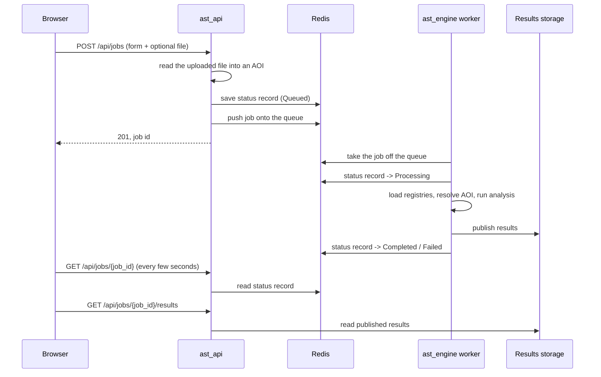

# Job flow: form to results

This note explains how a statusing job travels from the form in the browser to
the engine and back, and what each side needs configured for the two to meet.

## The path a job takes



## The shared contract

Both sides use the models in `shared_models/`, so neither has its own copy of
the message shape.

| Piece | Where | What it is |
| --- | --- | --- |
| `JobQueueItem` | `shared_models/models.py` | The job as it travels: who submitted it, the region, and where the AOI comes from. |
| Job queue | Redis list named by `job_queue` | One `JobQueueItem` per job, as JSON. The API pushes, the worker pops. |
| `JobStatusStore` | `shared_models/job_store.py` | One Redis key per job (`ast_job:<job_id>`) holding the job's current status. |
| Results | results storage, under the job's id | What the worker published; `results/results.raw.json` is the `AstResults` document. |

A job's id is a UUID given out by the API. The same id is on the queue message,
in the status record and in the results path.

## Where the area of interest comes from

| Source | What the API does | What the worker does |
| --- | --- | --- |
| Upload (`source` = `"2"`) | Reads the file into GeoJSON (EPSG:4326, geometry only) and puts it on the queue message. A file that cannot be used is refused with a `422`. | Uses the shape as sent. |
| TANTALIS (`source` = `"1"`) | Checks the three identifiers were given and puts them on the queue message. | Looks the parcel up in BCGW. This needs a BCGW login on the worker. |

Uploads accepted: `.geojson`, `.json`, `.kml`, `.kmz`, `.gpkg`, and `.zip`
holding one shapefile. A bare `.shp` is refused, because a shapefile without its
`.prj` has no coordinate system.

## Which datasets a job runs against

The worker loads its registries from the folder named by `registry_output_path`
(the folder the spreadsheet ingestion writes to), chosen by the job's region:

| File | Needed? |
| --- | --- |
| `one_status_common_datasets.yaml` | Required. |
| `one_status_<region>_specific.yaml` | Used when present, e.g. `one_status_kootenay_boundary_specific.yaml`. |
| `tab1.yaml` | Used when present. |

`ast_engine/tests/registry/demo/` holds a common registry over the sample
datasets in `ast_engine/tests/data`, so the whole flow can be run with no BCGW
login. It is built by `scripts/build_demo_registry.py`.

## API routes

| Route | Returns |
| --- | --- |
| `POST /api/jobs` | `201` with the queued job. `422` when the form or the uploaded file cannot be used, `413` when the file is over `max_upload_bytes`. |
| `GET /api/jobs/{job_id}` | The job and its status: `Queued`, `Processing`, `Completed` or `Failed` (with `error`). `404` when there is no such job. |
| `GET /api/jobs/{job_id}/results` | The published results of a completed job. `409` while the job has not completed or when it failed, `404` when there is no such job. |
| `GET /api/jobs/{job_id}/report` | The status report of a completed job, as an Excel workbook to download. |
| `GET /api/jobs/{job_id}/maps` | The HTML maps published for a completed job, as `name` and `title`, the overview first. Empty when the job made none. |
| `GET /api/jobs/{job_id}/maps/{map_name}` | One map, as a page to open in the browser. |
| `GET /api/jobs` | The jobs still waiting on the queue. |

## The status report

Every published job gets a status report: one Excel workbook holding the tabs of
the ArcGIS Pro Automated Status Tool, in the same order and layout.

| Sheet | What it holds | Written by |
| --- | --- | --- |
| Crown Land Status (Tab 1) | The status summary: the file, the applicant, what administrative areas the AOI falls in, and blank lines the business areas fill in. | `ast_engine/reporting/crown_land_status.py` |
| Status of Conflict (Tab 2) | The inactive Crown land tenures on the AOI. | `ast_engine/reporting/crown_land_status.py` |
| Conflicts & Constraints (Tab 3) | Every dataset under its category, with what the AOI overlaps in it. | `ast_engine/reporting/conflicts_report.py` |
| Data Sources | Where each dataset was read from, and its filter. | `ast_engine/reporting/conflicts_report.py` |

Each writer's module docstring lists what is the same as the ArcGIS Pro tool's
sheet and what differs.

Where the contents come from:

| Contents | Source |
| --- | --- |
| Tab 1 areas (mapsheet, districts, provincial forest, survey parcels, ALR, nearest Indian Reserve and archaeology site) | The `tab1` registry, run through the engine like any other. |
| Tab 1 file facts (applicant, received date, tenure type, legal description...) | TANTALIS, read by `ast_engine/core/data_adapters/oracle/tantalis_status.py`. Blank for an uploaded AOI. |
| Tab 2 | TANTALIS: the interest parcels the AOI touches, then the inactive tenures on them. |
| Tab 3 | The common and regional registries. |

The report says so when something was not looked up, rather than leaving it
looking clear:

- a Tab 1 line reads `FAILED` when its dataset could not be read and
  `Not checked` when it was not part of the run (no `tab1.yaml` in the registry
  folder);
- Tab 2 reads `ERROR: The AST was unable to evaluate...` when the worker has no
  BCGW connection or the lookup failed;
- a Tab 3 dataset reads `Unsuccessful` when it could not be checked, and
  `No data to display` when it was checked and found nothing.

A dataset's category on Tab 3 comes from the spreadsheet's `Category` column,
which the spreadsheet ingestion now carries into the registry. A registry built
before that has no categories, and its datasets are listed under the registry's
name until it is rebuilt.

When the job made maps the report links to them. The links are relative
(`maps/<name>.html`), which works in a copy of the job's published folder. Set
`API_PUBLIC_URL` on the worker to have them go through the API instead, so they
work from a downloaded report.

Tab 1 names the applicant and Tab 2 names tenure holders. That is personal
information: it is written into the report and never logged.

## Maps and exported overlap results

Two switches on the form change what the worker publishes besides the results
document:

| Switch | What the worker does |
| --- | --- |
| Generate Maps | Writes one HTML map per dataset that found features, and an overview map of them all, and publishes them under `maps/`. |
| Export Overlap Results | Publishes the features each dataset matched, as one GeoPackage per dataset per AOI part, under `data/`. |

Both are built from the features a run saves, so a job that asks for either has
them saved for that run whatever `RECORD_SPATIAL` is set to. The maps are made
by `ast_engine/reporting/html_maps.py`, which carries over the map output of the
ArcGIS Pro Automated Status Tool; its module docstring lists what is the same
and what differs. A map is a single HTML file with its data inside it. It loads
Leaflet, Turf and BC Sans from public CDNs and basemap tiles from GeoBC and
Esri, so the browser opening it needs internet access.

## Settings

Read from the environment or a `.env` file in the repo root. The API and the
worker must be given the same Redis and results-storage values.

| Setting | Used by | Purpose |
| --- | --- | --- |
| `REDIS_HOST`, `REDIS_PORT`, `REDIS_DATABASE`, `REDIS_PASSWORD` | both | The Redis holding the queue and the status records. |
| `JOB_QUEUE` | both | Name of the queue. Default `ast_job_queue`. |
| `JOB_STATUS_TTL_SECONDS` | both | How long a status record is kept. Default 7 days. |
| `STORAGE_TYPE`, `RESULTS_LOCAL_ROOT`, `RESULTS_S3_*` | both | Where results are published and read back. |
| `REGISTRY_OUTPUT_PATH` | worker | Folder holding the registry yaml files. |
| `ORACLE_USER`, `ORACLE_PASSWORD`, `ORACLE_HOST`, `ORACLE_DATABASE` | worker | BCGW login. Without it only file and GeoParquet datasets run, and TANTALIS jobs fail with a message saying so. |
| `MAX_UPLOAD_BYTES` | API | Largest uploaded file accepted. Default 20 MB. |
| `API_PUBLIC_URL` | worker | The address people reach the API at. When set, the status report's map links go through the API. |

## Run locally

Start Redis (or Valkey), then from the repo root, each in its own terminal:

```bash
# the worker, on the demo registry and local results storage
REGISTRY_OUTPUT_PATH=ast_engine/tests/registry/demo uv run python -m ast_engine.entry.redis_worker

# the API
uv run uvicorn ast_api.main:app --reload --port 8000

# the frontend
cd frontend && npm run dev
```

Submit the form with `ast_engine/tests/data/Test_Shape_A/Test_Shape_A.kml` as
the upload. The job's status appears under the buttons and a **View results**
link appears when it completes.

## Tests

```bash
uv run pytest ast_api/tests                  # API, job store and the end-to-end flow
uv run pytest ast_engine/tests/unit/test_worker.py ast_engine/tests/unit/test_job_builder.py ast_engine/tests/unit/test_redis_worker.py
```

`ast_api/tests/test_job_flow.py` runs one job through the real API route, queue
message, worker, engine and results route, with Redis replaced by an in-memory
fake and results storage on local disk.

## Not done yet

- The API does not check the login token the frontend holds.
- The TANTALIS lookups behind the report's first two tabs have only been run
  against a stand-in for the database. Their table and column names are the
  ones the ArcGIS Pro tool queries; a run against BCGW is still needed to
  confirm them.
- The `jobs` table in SQLite keeps the status a job was created with; the live
  status is the record in Redis.
